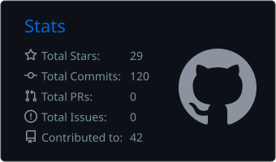
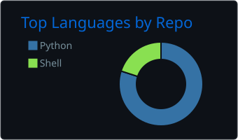

  

## About

Security leader and offensive security practitioner (CISSP, CRTO, PNPT; US Navy veteran). I build AI red team and autonomous security programs: multi-agent pentest orchestration, LLM and agent attack-surface testing, and the governance that keeps autonomous tooling safe to run.

Background: Wells Fargo (Offensive Security Research), Altimetrik (Head of Information Security), Apple, Intuit (Product Security / Red Team), PlayStation (Security GRC), Cigital (Red Team), Synack Red Team.

This GitHub is where I publish the public, vendor-neutral side of that work: AI attack tooling, red team playbooks, cloud pentest methodology and small security tools.

In my current role, the autonomous pentest program I run has surfaced 50+ critical vulnerabilities, each ticketed with a reproducible proof of concept, alongside 13 human-supervised AI security agents and 17 automated daily security checks.

## What I'm working on

- **Autonomous AI pentesting, orchestrated.** Coordinating open-source AI pentest agents ([Strix](https://github.com/usestrix/strix), [PentAGI](https://github.com/vxcontrol/pentagi), [Shannon](https://github.com/KeygraphHQ/shannon)) as one continuous program: multi-agent coordination, scheduled rotation across targets, human-in-the-loop approval gates, and findings that flow into triage only with a reproducible proof of concept.
- **Rules of engagement for AI agents.** Defined scan windows, no brute force, at most one credential-spray attempt per account, signed scope, full audit logging. Autonomy without guardrails is just an incident.
- **Human-in-the-loop agentic security operations.** Specialized agents for AppSec PR review, vulnerability and dependency remediation, compliance automation and vendor review, with every risky action behind a human approval gate.
- **LLM and agent attack surface.** Prompt injection, jailbreak chains, MCP/tool abuse and adversarial ML, alongside AI strategy coursework at MIT Sloan.

## Featured work (mine)

| Repo | What it is |
|---|---|
| [AI-Redteaming](https://github.com/byoniq/AI-Redteaming) | Curated, dated list of LLM/AI attack tooling: prompt injection, jailbreaks, agentic and MCP threats, adversarial ML |
| [Redteam-Runbook](https://github.com/byoniq/Redteam-Runbook) | MITRE ATT&CK-mapped red team engagement playbook: scoping/RoE, C2, AD/Entra ID, EDR evasion, purple teaming |
| [AWS-Security](https://github.com/byoniq/AWS-Security) | AWS penetration testing guide: IAM privilege escalation, S3, Lambda, EKS, cross-account paths |
| [BugBountyMethod](https://github.com/byoniq/BugBountyMethod) | Bug bounty / web and API testing methodology with tool-linked checklists |
| [jsleaks](https://github.com/byoniq/jsleaks) | Zero-dependency Python tool that finds API keys and secrets in JavaScript |
| [codeowner-scout](https://github.com/byoniq/codeowner-scout) | Maps CODEOWNERS coverage across a repo and scores unowned code |

## Tools I use and track

Open-source projects I run or study (all third-party, linked to their upstream repos): [Strix](https://github.com/usestrix/strix) · [PentAGI](https://github.com/vxcontrol/pentagi) · [Shannon](https://github.com/KeygraphHQ/shannon) · [HexStrike AI](https://github.com/0x4m4/hexstrike-ai) · [Flowsint](https://github.com/reconurge/flowsint) · [NeMo Guardrails](https://github.com/NVIDIA/NeMo-Guardrails)

## Stack

  

## GitHub stats

<!--
  These hosted URLs were verified 2026-11-10 ~10:55 AM PT as HTTP 200 image/svg+xml
  with real card content (not error placeholders).

  After the first successful run of .github/workflows/profile-graphics.yml,
  switch the src attributes to the durable copies on the output branch:

    https://raw.githubusercontent.com/byoniq/byoniq/output/stats.svg
    https://raw.githubusercontent.com/byoniq/byoniq/output/languages.svg
    https://raw.githubusercontent.com/byoniq/byoniq/output/streak.svg
    https://raw.githubusercontent.com/byoniq/byoniq/output/ghchart.svg
    https://raw.githubusercontent.com/byoniq/byoniq/output/github-contribution-grid-snake-dark.svg
-->

  
  

  

## Contribution graph

  

  <picture>
    <source media="(prefers-color-scheme: dark)" srcset="https://raw.githubusercontent.com/byoniq/byoniq/output/github-contribution-grid-snake-dark.svg" />
    
  </picture>

## Elsewhere

> Everything here is for authorized security testing and education only.

